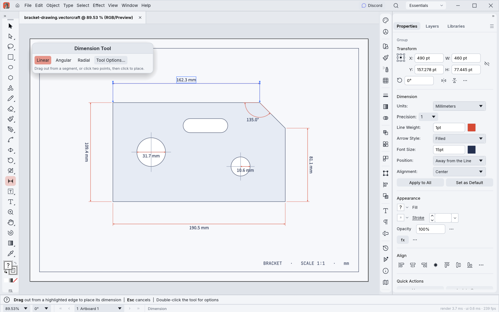
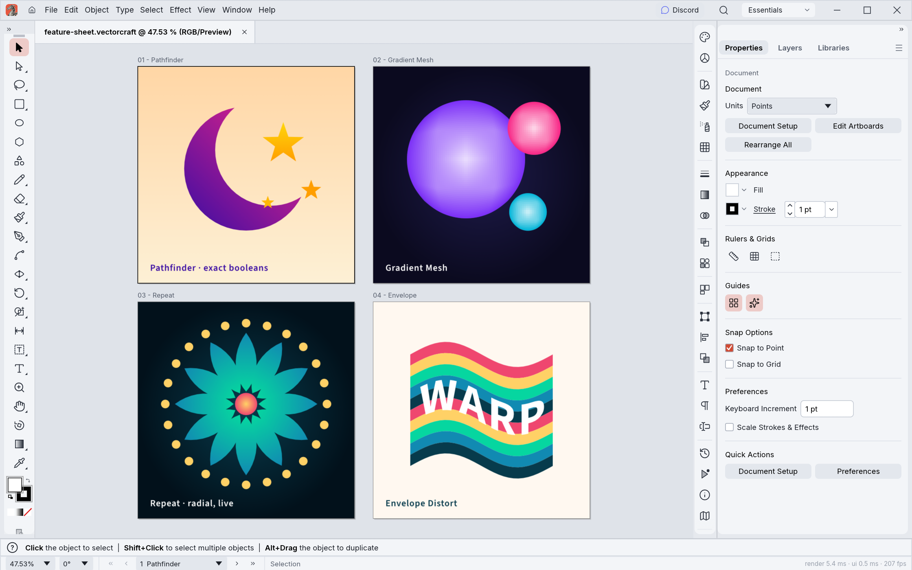
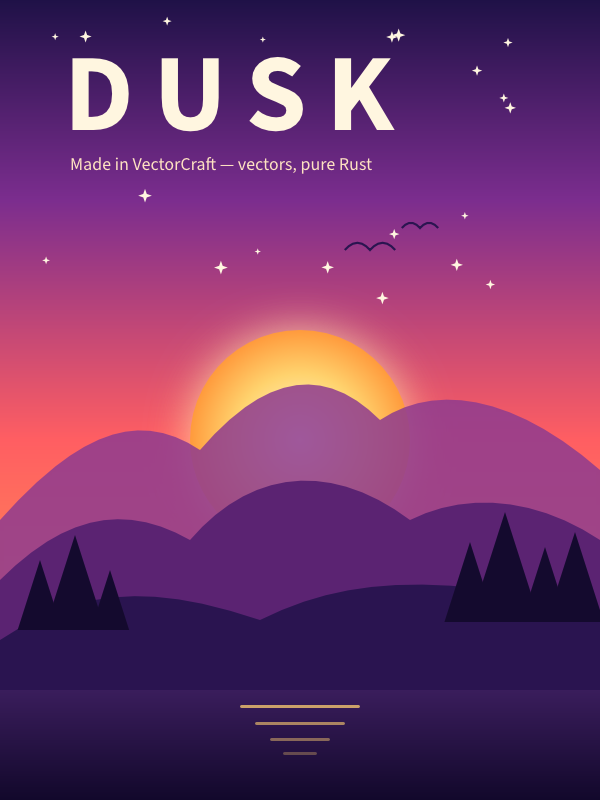
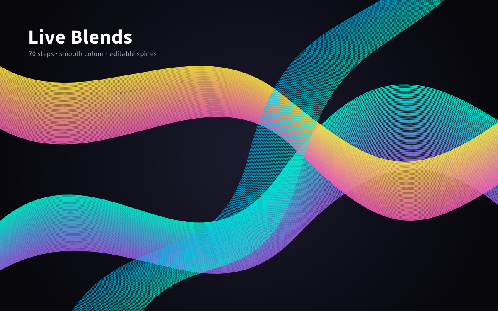
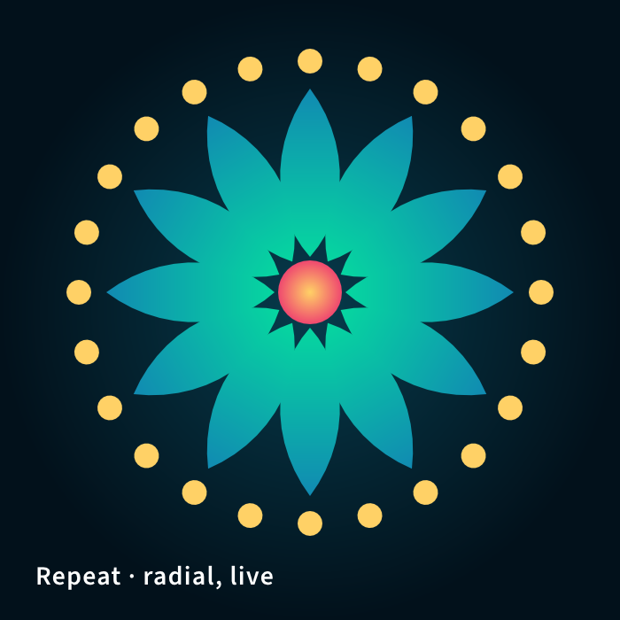
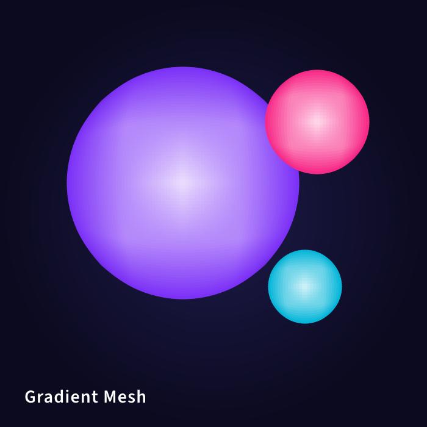

<p align="center">
  <a href="https://workflowind.agcunae.com/apps/">
    <picture>
      <source media="(prefers-color-scheme: dark)" srcset="docs/brand/novafoods-logo-white.svg">
      
    </picture>
  </a>
</p>


<h1 align="center">Nova Vector</h1>

<p align="center">
  <b>Vector illustration; an open-source, clean-room reimplementation of Adobe Illustrator, rebuilt in pure Rust.</b>
</p>

<p align="center">
  A fast, open-source, clean-room take on the Adobe Illustrator workflow. It runs natively on
  macOS, Windows, Linux and FreeBSD, and in the browser via WebAssembly. Built by the Nova Foods team.
</p>

<p align="center">
  
  
  
  
  
</p>

<p align="center">
  <a href="https://workflowind.agcunae.com/inbox"></a>
</p>

<p align="center">
  <a href="https://workflowind.agcunae.com/apps/novavector"><b>Nova Vector on workflowind.agcunae.com/apps</b></a> ·
  <a href="https://workflowind.agcunae.com/apps/">Nova Foods</a> ·
  <a href="https://workflowind.agcunae.com/apps">All Nova Foods Apps</a>
</p>

<br>

<p align="center">
  
  <br><sub><b>Neon Drive</b>: a Pathfinder-cut sun, live Outer Glow on the type and grid, and clipping masks · <code>examples/neon-drive.novavector</code></sub>
</p>

> [!NOTE]
> **Nova Foods is a community of artists from all walks of life.** Digital, generative, music,
> games &mdash; if you make things, you're one of us. **[Come say hi on Suporte](https://workflowind.agcunae.com/inbox).**

<p align="center">
  <a href="#a-look-around">A look around</a> ·
  <a href="#made-in-novavector">Made in Nova Vector</a> ·
  <a href="#why-novavector">Why Nova Vector</a> ·
  <a href="#quick-start">Quick start</a> ·
  <a href="#status">Status</a> ·
  <a href="#downloads">Downloads</a> ·
  <a href="#the-crafting-apps">The Nova Foods Apps</a> ·
  <a href="#license-and-credits">License</a>
</p>

## A look around

<table>
<tr>
<td width="50%" valign="top">
  
  <p align="center"><sub><b>Live Blends and Layers</b>: editable key paths, smooth colour, every object a row</sub></p>
</td>
<td width="50%" valign="top">
  
  <p align="center"><sub><b>Pen and Direct Selection</b>: real Bézier anchors and handles, plus a contextual task bar</sub></p>
</td>
</tr>
<tr>
<td width="50%" valign="top">
  
  <p align="center"><sub><b>3D Revolve</b>: smooth vector shading, caps and a rotation gizmo · <code>examples/still-life.novavector</code></sub></p>
</td>
<td width="50%" valign="top">
  
  <p align="center"><sub><b>Dimension tool</b>: lengths, angles and radii that follow the art they measure · <code>examples/bracket-drawing.novavector</code></sub></p>
</td>
</tr>
<tr>
<td width="50%" valign="top">
  
  <p align="center"><sub><b>Perspective Grid</b>: art attached to its planes stays editable in perspective · <code>examples/perspective-city.novavector</code></sub></p>
</td>
<td width="50%" valign="top">
  
  <p align="center"><sub><b>Multiple artboards, light theme</b>: Pathfinder · Gradient Mesh · live radial Repeat · Envelope Distort · <code>examples/feature-sheet.novavector</code></sub></p>
</td>
</tr>
</table>

## Made in Nova Vector

Every piece below was built entirely through Nova Vector's command API, the same one the MCP server
exposes to agents, and exported by Nova Vector's own renderer. The source files are in
[`examples/`](examples).

<table>
<tr>
<td width="50%" valign="top">
  
  <p align="center"><sub><b>Neon Drive</b>: synthwave poster with glowing type and grid</sub></p>
</td>
<td width="50%" valign="top">
  
  <p align="center"><sub><b>Dusk</b>: gradient sky, glowing sun, layered mountains</sub></p>
</td>
</tr>
<tr>
<td colspan="2" valign="top">
  
  <p align="center"><sub><b>Live Blends</b>: 70 steps, smooth colour, editable spines</sub></p>
</td>
</tr>
<tr>
<td colspan="2" valign="top">
  
  <p align="center"><sub><b>Still Life</b>: four revolved profiles with smooth vector shading</sub></p>
</td>
</tr>
<tr>
<td width="50%" valign="top">
  
  <p align="center"><sub><b>Radial Repeat</b>: a live mandala</sub></p>
</td>
<td width="50%" valign="top">
  
  <p align="center"><sub><b>Envelope Distort</b>: striped type warped into a flag</sub></p>
</td>
</tr>
<tr>
<td width="50%" valign="top">
  
  <p align="center"><sub><b>Gradient Mesh</b>: shaded spheres</sub></p>
</td>
<td width="50%" valign="top">
  
  <p align="center"><sub><b>Pathfinder</b>: a crescent and stars from exact booleans</sub></p>
</td>
</tr>
</table>

## Why Nova Vector

- **Familiar.** Illustrator's layout, tools, menus, panels and shortcuts: the Pen, Direct Selection,
  Pathfinder, Smart Guides, Appearance, Swatches, Layers and more. You already know how to use it.
- **Fast.** Multithreaded SIMD rendering off the UI thread. 20,000 shapes render in about 27 ms at
  full retina resolution while the interface stays at 120 fps.
- **Robust.** Exact curve booleans (no "cannot perform operation"), unlimited undo via structural
  sharing, and property-tested file round trips.
- **Open.** A documented native format (`.novavector`, JSON), first-class SVG, PDF (and
  PDF-compatible `.ai`) import and export, PNG/JPEG/WebP export, Export for Screens, and SVGZ,
  templates, GIF, TIFF and BMP on open.
- **Agent-native.** Every menu item, tool gesture, panel and dialog can be driven over a JSON
  control channel and an **MCP server**, so Claude and other agents can draw, edit and export the
  way a person does.
- **Everywhere.** One codebase for the desktop apps and the same UI in the browser.

## Quick start

```sh
git clone https://github.com/EuLucaDev/novavector
cd novavector

cargo run --release -p novavector                          # desktop app
cargo run --release -p novavector -- examples/dusk-poster.novavector
cargo run --release -p novavector -- --control 7979        # + JSON control channel
cargo run --release -p novavector-cli -- mcp               # MCP server (stdio)
cargo run --release -p novavector-cli -- run --in examples/ribbons.novavector --export out.pdf   # headless batch
cargo run --release -p novavector-cli -- bench examples/neon-drive.novavector                   # render timing
cargo xtask bundle                                        # dist/Nova Vector.app (macOS)
cd apps/novavector-web && trunk build --release            # web build → dist/web
cargo xtask ci                                            # fmt, clippy, tests, layering, wasm, vendor names
```

Japanese fonts come from [EuLucaDev/novafoods-fonts](https://github.com/EuLucaDev/novafoods-fonts), an optional
build input (releases always use it): `NOVAFOODS_FONTS_DIR="$PWD/../novafoods-fonts" cargo run --release -p novavector` (an absolute path).
Without it, Japanese text uses the installed system fonts. See [`docs/development.md`](docs/development.md#fonts-novafoods-fonts-optional-build-input).

On machines with two graphics processors, Nova Vector renders on the power-saving (integrated) one by default on
Windows and macOS, and on the one the desktop runs on under Linux. To choose, use **Preferences › Performance ›
Graphics Processor** and restart. If a graphics processor can't show the window, Nova Vector starts again on the
next one. To pick one when starting the app, set `WGPU_POWER_PREF=high` (or `low`), or `WGPU_ADAPTER_NAME` to part of
its name, such as `WGPU_ADAPTER_NAME=nvidia` (see [`docs/development.md`](docs/development.md#desktop-graphics-processor)).

On native Wayland, winit 0.30 does not deliver dropped files. To open an SVG, use File › Open;
to place artwork in the current document, copy and paste the file in a file manager. For file
drag-and-drop, set **Preferences › Performance › Linux Display Server** to **X11 (XWayland)** and restart, or start
the app with `WAYLAND_DISPLAY= novavector`: the window then opens through XWayland, where drops work
(see [`docs/development.md`](docs/development.md#linux-wayland-and-x11)).

On Linux under KDE Plasma 6.3 or later with Wayland, a drawing tablet's pen moves the cursor but Nova Vector doesn't
respond to it yet (#491). Open the window through XWayland instead, with the same preference or `WAYLAND_DISPLAY= novavector` (see
[`docs/development.md`](docs/development.md#linux-wayland-and-x11)).

### Use it from Claude Code and other agents

Register the MCP server with Claude Code:

```sh
claude mcp add novavector -- /path/to/novavector-cli mcp
```

To keep an agent to one project's files, give it folders to read and write (the same flags as Nova Photo):

```sh
claude mcp add novavector -- /path/to/novavector-cli mcp --automation-read-root /work/project --automation-write-root /work/project
```

The details are in [`docs/mcp.md`](docs/mcp.md) and [`docs/control-protocol.md`](docs/control-protocol.md).

For the experimental, unsupported 64-bit Windows 7 build, see [Windows 7 instructions](docs/windows7.md).

## Status

Nova Vector is under active development. [**ROADMAP.md**](ROADMAP.md) has the stage, the numbers by dimension
and what's next; [`docs/target-app-parity.md`](docs/target-app-parity.md) the full parity assessment and
[`docs/gaps.md`](docs/gaps.md) the ranked list of what's missing.

**Where we are (2026-10-10): alpha.** About 88% of Illustrator 2026's menu items, tools, effects and formats exist
(92.5% of menu items do something), feature depth is ~75%, and we estimate ~65% "ready for real work" for a mainstream illustrator (~62% against
all of Illustrator): everyday
vector illustration is close to usable: drawing and path tools,
Pathfinder and Shape Builder, paint, gradients, appearance and transparency, type with styles, threading and Hebrew/Arabic bidirectional layout, and
files (SVG, PDF and PDF-compatible `.ai` with PDF/X, legacy version 7 `.ai` keeping layers, groups and type, EPS, DXF, EMF/WMF, raster formats, PSD out and PSD/PSB in as their merged image, Print, Package).
Affinity documents (`.af` from Affinity 3, `.afdesign`, `.afpub` and, by their content, `.afphoto` from Affinity 1 and 2) open
and place natively: layers, groups, artboards and pages, curves and shapes, fills, gradients and strokes, clipping
and masks, text and images, with what didn't come in (effects, adjustments, brushes, master pages…) listed in the
import warning; a file whose native data can't be read opens as its embedded preview, saying why. Nova Vector
doesn't write Affinity files. Current `.af` validation includes 33 pinned files, native save/reload
and every-board SVG/PDF/PSD export, with fixes for Affinity 3 artboards, source-backed JPEGs and text runs.
[Scope and limits](crates/affinity/README.md); [source audit and remaining gaps](docs/affinity-validation.md).
The interface
speaks English, German, Japanese, Korean, Vietnamese, Traditional and Simplified Chinese, Spanish, French, Hungarian, Italian, Polish, Brazilian Portuguese, Russian, Swedish, Ukrainian, Finnish, Bulgarian, Greek and Czech;
[localization-parity.md](docs/localization-parity.md) has the details.
The scores are self-assessed from our code against Illustrator's public documentation;
[target-app-parity.md](docs/target-app-parity.md#how-this-was-measured-2026-10-10) explains how far to trust them.

**What's missing:**
- reliable exchange of Illustrator's own `.ai` files (layer structure in real files; Illustrator's editing data isn't written);
- an interaction-fidelity pass covering every tool's modifiers and small behaviours;
- 3D and Materials beyond the initial live Revolve (Extrude & Bevel, Inflate, Rotate, materials);
- about half of the Photoshop-style raster effects (27 of 57 still missing; Film Grain is available under Artistic, Halftone Pattern under Sketch) and the Effect Gallery;
- CJK composition for vertical type (vertical type itself has initial support, with a Japanese interface);
- scripting, and the rest of Variables (image and graph kinds, dataset import);
- generative AI features.

**Where we're going:** next is the interaction-fidelity pass, `.ai` files from real users and start-up stability,
alongside the raster-effects package; then type, the Illustrator 2026 additions and 3D. The ranked list is in
[`docs/gaps.md`](docs/gaps.md).

**Workspace:** `crates/{geom, color, doc, pathops, text, effects, three-d, trace, brush, render, svg, pdf, eps, cad, metafile, format, tools, engine, ui-egui, mcp, testkit}`
and `apps/{novavector, novavector-cli, novavector-web}`. The egui frontend is its own crate, so
the UI can be swapped without touching the engine.

Agent and contributor rules (clean-room, the asset policy, no panics in shipped code, quality gates) are in
[`AGENTS.md`](AGENTS.md); [`docs/development.md`](docs/development.md#robustness-novavector-never-crashes)
explains how Nova Vector avoids crashing, and [`docs/releasing.md`](docs/releasing.md) how releases are built,
signed and published. Every bundled asset is listed with its licence in [`ASSETS.md`](ASSETS.md).

## Downloads

**New to Nova Vector?** Download it from the [Nova Vector page on workflowind.agcunae.com/apps](https://workflowind.agcunae.com/apps/novavector). That's the easiest way to install it.

**Want a specific build or format?** On GitHub, the [latest release](https://github.com/EuLucaDev/novavector/releases/latest) has every build listed below, and [all releases](https://github.com/EuLucaDev/novavector/releases) has earlier versions and their notes. `<ver>` in the file names is the version number, and `SHA256SUMS.txt` lists a checksum for every file.

### Windows

| Build | Installer | Portable |
|---|---|---|
| x64 (64-bit Intel/AMD) | `novavector-<ver>-windows-x64.msi` | `novavector-<ver>-windows-x64-portable.zip` |
| arm64 (Snapdragon and other ARM PCs) | `novavector-<ver>-windows-arm64.msi` | `novavector-<ver>-windows-arm64-portable.zip` |
| x86 (32-bit) | `novavector-<ver>-windows-x86.msi` | `novavector-<ver>-windows-x86-portable.zip` |

Installers and executables are code-signed.

### macOS

| Build | File | Notes |
|---|---|---|
| App, universal (Apple silicon + Intel) | `novavector-<ver>-macos-universal.dmg` | Signed and notarized |
| Command-line tool, universal | `novavector-cli-<ver>-macos-universal.zip` | Signed and notarized |

### Linux

| Format | x86_64 | aarch64 (ARM64) | Notes |
|---|---|---|---|
| AppImage | `novavector-<ver>-linux-x86_64.AppImage` | `novavector-<ver>-linux-aarch64.AppImage` | Runs anywhere; updates itself with [AppImageUpdate](https://github.com/AppImageCommunity/AppImageUpdate) (`.zsync` files) |
| Flatpak | `novavector-<ver>-linux-x86_64.flatpak` | `novavector-<ver>-linux-aarch64.flatpak` | Sandboxed; `flatpak install --user <file>` |
| Debian/Ubuntu | `novavector-<ver>-linux-x86_64.deb` | `novavector-<ver>-linux-aarch64.deb` | |
| Fedora/RHEL/openSUSE | `novavector-<ver>-linux-x86_64.rpm` | `novavector-<ver>-linux-aarch64.rpm` | |
| Tarball | `novavector-<ver>-linux-x86_64.tar.gz` | `novavector-<ver>-linux-aarch64.tar.gz` | Unpack anywhere |

### FreeBSD

| Build | File |
|---|---|
| x86_64 | `novavector-<ver>-freebsd-x86_64.tar.gz` |

### Web (WebAssembly)

| Build | File | Notes |
|---|---|---|
| Static site | `novavector-web-<ver>.zip` | Runs in a modern browser; host it on any static server |

## The Nova Foods Apps

Nova Vector is one of the **Nova Foods Apps**: free, open-source creative tools from the
[Nova Foods](https://workflowind.agcunae.com/apps/) team, each written from scratch in Rust and each able to
stand on its own.

| | App | What it's for | Code | Learn more |
|:-:|---|---|---|---|
|  | **Nova Photo** | Image editing: layers, masks, type and real PSD files | [GitHub](https://github.com/EuLucaDev/novaphoto) | [Website](https://workflowind.agcunae.com/apps/novaphoto) |
|  | **Nova Vector** | **Vector illustration · you are here** | [GitHub](https://github.com/EuLucaDev/novavector) | [Website](https://workflowind.agcunae.com/apps/novavector) |
|  | **Nova Film** | Video editing, color and sound | [GitHub](https://github.com/EuLucaDev/novafilm) | [Website](https://workflowind.agcunae.com/apps/novafilm) |
|  | **Nova Light** | Photo library and raw development | [GitHub](https://github.com/EuLucaDev/novalight) | [Website](https://workflowind.agcunae.com/apps/novalight) |
|  | **Nova PDF** | Reading, organizing and protecting PDFs | [GitHub](https://github.com/EuLucaDev/novapdf) | [Website](https://workflowind.agcunae.com/apps/novapdf) |
|  | **Nova Effect** | Motion graphics and visual effects | [GitHub](https://github.com/EuLucaDev/novaeffect) | [Website](https://workflowind.agcunae.com/apps/novaeffect) |
|  | **Nova Design** | Page layout and publishing | [GitHub](https://github.com/EuLucaDev/novadesign) | [Website](https://workflowind.agcunae.com/apps/novadesign) |

And [**Nova Foods**](https://workflowind.agcunae.com/apps/) itself, our AI image and video studio for artists who want real control.

<br>

<p align="center">
  <a href="https://workflowind.agcunae.com/inbox"></a>
</p>

<h3 align="center">Come make things with us</h3>

<p align="center">
  Our Suporte is where artists of every kind hang out: people who paint, shoot, draw, cut film,
  set type, and people still figuring out what they like to make. Share what you're working on,
  ask for help, tell us what's broken, or tell us what you wish these tools could do.
  Whatever your medium and however long you've been at it, you're welcome here.
</p>

<p align="center">
  <a href="https://workflowind.agcunae.com/inbox"><b>workflowind.agcunae.com/inbox</b></a> ·
  <a href="https://workflowind.agcunae.com/apps/">workflowind.agcunae.com/apps</a> ·
  <a href="https://workflowind.agcunae.com/apps">The Nova Foods Apps</a> ·
  <a href="https://workflowind.agcunae.com/apps/novavector">Nova Vector</a>
</p>

## Star history

[](https://www.star-history.com/?repos=EuLucaDev%2Fnovavector&type=date&legend=top-left)

## License and credits

Nova Vector is dual-licensed under [MIT](LICENSE-MIT) or [Apache-2.0](LICENSE-APACHE), at your option.
Copyright (c) 2026 Nova Foods Team and the Nova Vector contributors. Required notices are in [NOTICE](NOTICE).

Bundled fonts, icons, images and other assets keep their own open licenses; each one is listed
with its author, source and license in [ASSETS.md](ASSETS.md). Release builds also embed the
fonts of [novafoods-fonts](https://github.com/EuLucaDev/novafoods-fonts/blob/main/ATTRIBUTION.md) (Japanese,
Simplified Chinese and Arabic faces; SIL Open Font License 1.1).

The app icon (an engraved dragon on Nova Vector red, `#e8573f`) is the owner's original artwork; its
palette and files are in [`assets/app-icon/`](assets/app-icon/README.md).

The Nova Foods name, wordmark and logos in [`docs/brand/`](docs/brand/) are trademarks of the
Nova Foods Team and are not covered by this license. They may be used only unmodified, and only as
part of this repository and Nova Vector, under [`docs/brand/LICENSE-brand.txt`](docs/brand/LICENSE-brand.txt).
Forks and modified versions must remove them.

<sub>Adobe, Photoshop, Illustrator, Premiere Pro, Lightroom, Acrobat, After Effects and InDesign are trademarks or registered trademarks of Adobe Inc. in the United States and/or other countries. Nova Vector is an independent, open-source project and is not affiliated with, sponsored by or endorsed by Adobe Inc.; these names are used only to describe the workflows it is compatible with.</sub>

<p align="center">
  <a href="https://workflowind.agcunae.com/apps/"></a><br>
  <sub>Made by the <a href="https://workflowind.agcunae.com/apps/">Nova Foods</a> team and community.</sub>
</p>
